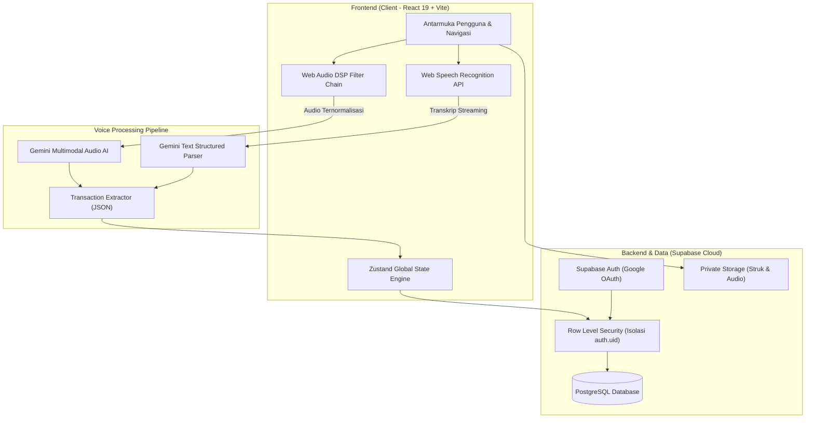

# Monetra

<div align="center">


### Asisten Keuangan Pribadi Berbasis AI & Pelacak Pengeluaran Pintar
**Catat transaksi secepat berbicara, kelola anggaran dengan aturan 50/30/20, dan evaluasi kesehatan finansial Anda secara real-time.**

[](https://react.dev/)
[](https://www.typescriptlang.org/)
[](https://tailwindcss.com/)
[](https://vitejs.dev/)
[](https://supabase.com/)
[](https://ai.google.dev/)
[](LICENSE)

[Fitur Unggulan](#-fitur-unggulan) • [Teknologi](#-arsitektur--teknologi) • [Cara Kerja Voice AI](#-cara-kerja-voice-to-transaction) • [Panduan Instalasi](#-panduan-instalasi--menjalankan-lokal) • [Struktur Proyek](#-struktur-direktori)

</div>

---

## Ringkasan Produk

Banyak orang gagal mengelola keuangan pribadi bukan karena tidak punya niat, melainkan karena proses pencatatan manual yang lambat, melelahkan, dan mudah terlupakan. Aplikasi pencatat konvensional menuntut pengguna mengetik angka satu per satu, memilih kategori secara manual, dan hanya berakhir sebagai buku kas pasif tanpa memberi arahan konkret.

**Monetra** hadir untuk mengubah cara Anda berinteraksi dengan uang Anda:
1. **Pencatatan Tanpa Mengetik:** Cukup ceritakan pengeluaran Anda lewat rekaman suara. Monetra memproses ucapan Anda menjadi catatan transaksi terstruktur dalam hitungan detik.
2. **Kecerdasan Kontekstual:** AI tidak hanya menyimpan angka, melainkan mengelompokkan pos pengeluaran berdasarkan metodologi finansial teruji (50/30/20), mengenali kebiasaan Anda, dan memberikan peringatan sebelum anggaran bulanan terlampaui.
3. **Privasi & Keamanan Penuh:** Data Anda diisolasi menggunakan *Row Level Security* (RLS) PostgreSQL di Supabase. Anda memegang kendali penuh atas data dan riwayat AI Anda.

---

## Fitur Unggulan

### 1. Pencatatan Suara Pintar (Voice-to-Transaction AI)
* **Ekstraksi Multi-Transaksi:** Sebutkan beberapa transaksi sekaligus dalam satu kalimat (misal: *"Tadi makan siang soto 20 ribu, beli bensin 30 ribu, sama tadi sore ditransfer adik 150 ribu"*). AI akan otomatis memecahnya menjadi 3 transaksi berbeda dengan nominal, tipe, dan kategori yang tepat.
* **Pemahaman Bahasa Percakapan Indonesia:** Mendukung istilah nominal kasual sehari-hari (*ceban, goceng, seceng, noceng, goban, cepek, 50 rebu, 1,5 juta*).
* **Pemfilteran Suara Manusia (Vocal DSP):** Dilengkapi rangkaian pemrosesan audio *High-Pass*, *Formant Peaking*, dan *Dynamic Compression* menggunakan Web Audio API untuk meredam kebisingan sekitar dan memprioritaskan frekuensi vokal pengguna.
* **Streaming Teks Real-Time:** Menampilkan kata demi kata yang diucapkan secara langsung pada layar di browser mobile (iOS Safari & Android Chrome).

### 2. Konsultan Finansial Cerdas (AI Financial Advisor)
* Asisten percakapan interaktif bertenaga Google Gemini.
* Menganalisis pola arus kas harian, mingguan, dan bulanan.
* Memberikan rekomendasi alokasi dana darurat, evaluasi pengeluaran impulsif, dan simulasi perencanaan tabungan.
* Dilengkapi *AI Memory Engine* yang mengingat profil, preferensi gaya komunikasi, dan target finansial Anda.

### 3. Metodologi Alokasi 50/30/20 & Manajemen Anggaran
* Pengelompokan transaksi otomatis ke dalam 3 pilar:
  * **Kebutuhan (Needs - 50%):** Makanan pokok, tagihan, transportasi, kesehatan.
  * **Keinginan (Wants - 30%):** Hiburan, belanja hobi, gaya hidup, makan di restoran.
  * **Tabungan & Investasi (Savings - 20%):** Tabungan masa depan, dana darurat, cicilan.
* Batas anggaran per kategori dengan indikator visual dan peringatan dini saat mendekati limit.

### 4. Analisis & Visualisasi Arus Kas
* Grafik visual interaktif berbasis Recharts:
  * Perbandingan pemasukan vs pengeluaran.
  * Distribusi pos pengeluaran per kategori.
  * Filter rentang waktu fleksibel (Mingguan, Bulanan, Tahunan).
* Perhitungan saldo bersih (*Net Cash Flow*) secara otomatis.

### 5. Multi-Dompet, Target Tabungan & Manajemen Utang
* **Multi-Wallet:** Pisahkan pencatatan saldo Tunai (*Cash*), Rekening Bank, dan E-Wallet (*GoPay, OVO, Dana, ShopeePay*).
* **Target Impian (Financial Goals):** Tentukan target nominal dan batas waktu, pantau progres tabungan secara berkala.
* **Buku Utang & Piutang:** Catat siapa yang meminjam dana atau kepada siapa Anda berutang, lengkap dengan status pelunasan.

### 6. Desain Antarmuka Glassmorphism "Titanium & Ember"
* Bahasa desain visual bersih, berkelas, dan minimalis.
* Palet warna *Titanium & Ember Copper*: perpaduan nuansa baja gelap modern dengan aksen tembaga hangat.
* **Nir-Emoji (Zero-Emoji Policy):** Menggunakan ikon vektor garis tipis (SVG) murni untuk menghadirkan kesan aplikasi profesional setara platform perbankan premium.
* Responsif penuh pada perangkat ponsel (iOS / Android), tablet, hingga monitor desktop.
* Dukungan tema gelap (*Dark Titanium*) dan tema terang (*Porcelain Mist*).

---

## Arsitektur & Teknologi



### Rincian Pustaka & Komponen Utama

| Komponen | Pustaka / Layanan | Fungsi & Kegunaan |
| :--- | :--- | :--- |
| **Framework** | [React 19](https://react.dev/) | Library UI berbasis komponen modern |
| **Bahasa** | [TypeScript](https://www.typescriptlang.org/) | Type-safety mutlak, refactoring aman, dan autocompletion |
| **Styling** | [Tailwind CSS v4](https://tailwindcss.com/) | Utilitas CSS modern dan performan tinggi |
| **Bundler** | [Vite 8](https://vitejs.dev/) | Server dev berkecepatan tinggi dan build produksi efisien |
| **State Manager** | [Zustand](https://github.com/pmndrs/zustand) | Manajemen state global ringan dengan persistensi lokal |
| **Grafik Data** | [Recharts](https://recharts.org/) | Visualisasi diagram batang, garis, dan donat interaktif |
| **Animasi** | [Framer Motion](https://www.framer.com/motion/) | Transisi halaman, modal pop-up, dan indikator mikrofon halus |
| **Ikonografi** | [Lucide React](https://lucide.dev/) | Set ikon SVG garis tipis yang bersih dan konsisten |
| **Database & Auth** | [Supabase](https://supabase.com/) | PostgreSQL dengan RLS, Auth terintegrasi, dan REST/Realtime API |
| **Model AI** | [Google Gemini 2.5 Flash](https://ai.google.dev/) | Transkripsi multimodal, ekstraksi entitas JSON, dan chatbot penasihat |

---

## Cara Kerja Voice-to-Transaction

Sistem pencatatan suara Monetra dirancang khusus agar andal digunakan di kondisi nyata (seperti saat berjalan di jalan raya, berada di kafe yang bising, atau menggunakan mikrofon ponsel):

```
+------------------+      +---------------------------+      +--------------------------+
|  Input Mikrofon  | ---> |   Web Audio DSP Filter    | ---> |  Gemini Multimodal AI    |
| (Vokal Pengguna) |      | - High-Pass Filter (85 Hz)|      | - Isolasi Vokal Depan    |
+------------------+      | - Vocal Boost (2.400 Hz)  |      | - Pemahaman Slang Rupiah |
                          | - Low-Pass Filter (7.5 kHz|      +--------------------------+
                          | - Dynamics Compressor     |                   |
                          +---------------------------+                   v
                                                             +--------------------------+
                                                             |   JSON Multi-Transaksi   |
                                                             | - Jumlah & Kategori      |
                                                             | - Tipe (Expense/Income)  |
                                                             | - Alokasi 50/30/20       |
                                                             +--------------------------+
```

1. **Acoustic Conditioning:** Mikrofon menangkap suara dan melewati rangkaian Web Audio Node:
   * **85 Hz High-Pass:** Mengeliminasi getaran tangan pada bodi ponsel dan hembusan angin mikrofon.
   * **2.400 Hz Peaking (+5 dB):** Mengangkat frekuensi artikulasi konsonan bahasa Indonesia agar jelas terdengar.
   * **7.500 Hz Low-Pass:** Memotong derau statis, gesekan pakaian, dan suara kipas/AC.
   * **Dynamics Compressor:** Mengangkat suara pelan tanpa membuat suara keras menjadi terdistorsi.
2. **Neural Understanding:** Gemini Multimodal memisahkan suara pengguna dari latar belakang, mengenali konteks belanja, dan mengekstrak entitas finansial dalam format JSON terstruktur.
3. **Konfirmasi Instan:** Pengguna melihat kartu tinjauan transaksi dengan tombol simpan satu ketukan.

---

## Panduan Instalasi & Menjalankan Lokal

### Prasyarat Sistem
* [Node.js](https://nodejs.org/) versi 18.0 atau yang lebih baru.
* Manajer paket: `npm`, `pnpm`, atau `yarn`.
* Akun [Supabase](https://supabase.com/) (tersedia tier gratis).
* *(Opsional)* Google Gemini API Key dari [Google AI Studio](https://aistudio.google.com/).

### Langkah 1: Kloning Repositori
```bash
git clone https://github.com/RendyGH7/Monetra-Apps.git
cd Monetra-Apps
```

### Langkah 2: Pasang Dependensi
```bash
npm install
```

### Langkah 3: Konfigurasi Environment Variables
Salin berkas konfigurasi contoh ke `.env.local`:
```bash
cp .env.example .env.local
```

Buka `.env.local` dan lengkapi variabel berikut:
```env
# Konfigurasi Supabase
VITE_SUPABASE_URL=https://proyek-anda.supabase.co
VITE_SUPABASE_ANON_KEY=kunci-anon-proyek-anda

# Kunci API Google Gemini (Opsional jika ingin menggunakan AI bawaan cloud)
VITE_GEMINI_API_KEY=kunci-gemini-anda
```

> **Catatan:** Jika `VITE_GEMINI_API_KEY` tidak diisi di berkas `.env.local`, pengguna tetap dapat memasukkan API Key secara mandiri melalui menu **Pengaturan** di dalam aplikasi, atau menggunakan *Local Reasoning Engine* bawaan.

### Langkah 4: Setup Database Supabase
Jalankan berkas migrasi SQL yang tersedia di direktori `supabase/migrations/` pada SQL Editor dasbor Supabase Anda:
1. `supabase/migrations/20261028_init_finai_schema.sql` (Inisialisasi tabel dasar: profil, transaksi, kategori, dompet, budget, goal, memori).
2. `supabase/migrations/20261030_create_monetra_user_data.sql` (Optimasi indeks dan kebijakan RLS).

### Langkah 5: Jalankan Server Pengembangan
```bash
npm run dev
```
Buka peramban Anda di `http://localhost:5173`.

### Langkah 6: Kompilasi untuk Produksi
```bash
npm run build
```
Hasil build siap disajikan di folder `dist/` dan siap dideploy ke Vercel, Netlify, atau Cloudflare Pages.

---

## Struktur Direktori

```
Monetra-App/
├── public/                 # Favicon, ikon PWA, dan aset statis
├── src/
│   ├── components/         # Komponen UI modular
│   │   ├── common/         # Komponen bersama (Toast, Modal, Markdown Renderer)
│   │   ├── layout/         # Navigasi bawah (BottomNav), Sidebar, Mascot
│   │   └── voice/          # Modal perekaman suara, visualizer audio, & filter DSP
│   ├── data/               # Nilai awal kategori standar dan template profil
│   ├── features/           # Halaman utama aplikasi
│   │   ├── analytics/      # Grafik arus kas & analisis konsumsi
│   │   ├── assistant/      # Antarmuka chat asisten finansial AI
│   │   ├── auth/           # Halaman otentikasi & masuk Google
│   │   ├── budget/         # Manajemen alokasi anggaran 50/30/20
│   │   ├── dashboard/      # Ringkasan saldo, statistik cepat, dan aksi instan
│   │   ├── settings/       # Pengaturan profil, preferensi tema, & konfigurasi AI
│   │   └── transactions/   # Riwayat lengkap, filter transaksi, & form manual
│   ├── lib/                # Konfigurasi klien Supabase
│   ├── services/           # Logika integrasi AI (Gemini Multimodal & Reasoning)
│   ├── store/              # Global state management (Zustand)
│   ├── types/              # Deklarasi tipe data TypeScript
│   └── utils/              # Pemformat mata uang (IDR), waktu WIB, parser teks
├── supabase/
│   └── migrations/         # Skrip skema database PostgreSQL & aturan RLS
├── package.json            # Daftar pustaka dan script proyek
├── tailwind.config.js      # Konfigurasi tema dan token visual
├── vite.config.ts          # Konfigurasi bundler Vite
└── README.md               # Dokumentasi utama proyek
```

---

## Keamanan & Perlindungan Privasi

* **Row Level Security (RLS):** Setiap tabel di PostgreSQL dilindungi aturan ketat `auth.uid() = user_id`. Pengguna tidak akan pernah bisa mengakses atau membaca data finansial pengguna lain.
* **Pemrosesan Audio Tanpa Jejak:** Rekaman audio diproses langsung dalam memori sesi untuk dianalisis oleh AI dan tidak disimpan secara permanen di server publik.
* **Kunci API Terlindungi:** Kunci API Gemini disimpan secara lokal di penyimpanan privat peramban pengguna atau diakses aman melalui backend proxy.
* **Penghapusan Data Penuh:** Pengguna memiliki hak privasi mutlak untuk mereset seluruh data transaksi dan memori AI kapan saja melalui menu pengaturan.

---

## Kontribusi & Pengembangan

Kami menyambut kontribusi dari komunitas pengembang! Jika Anda menemukan bug atau memiliki ide perbaikan fitur:

1. Lakukan **Fork** pada repositori ini.
2. Buat branch fitur baru (`git checkout -b fitur/nama-fitur-baru`).
3. Lakukan commit perubahan Anda (`git commit -m 'feat: tambahkan fitur baru'`).
4. Pastikan typecheck dan build berjalan sukses (`npm run build`).
5. Push branch Anda (`git push origin fitur/nama-fitur-baru`).
6. Ajukan **Pull Request**.

---

## Lisensi

Proyek ini didistribusikan di bawah lisensi **MIT**. Silakan tinjau berkas [LICENSE](LICENSE) untuk informasi selengkapnya.

<div align="center">

Dibangun dengan dedikasi untuk membantu semua orang mengelola keuangan secara lebih cerdas, tertib, dan bebas stres.

**[Monetra Team](https://github.com/RendyGH7/Monetra-Apps)**

</div>
