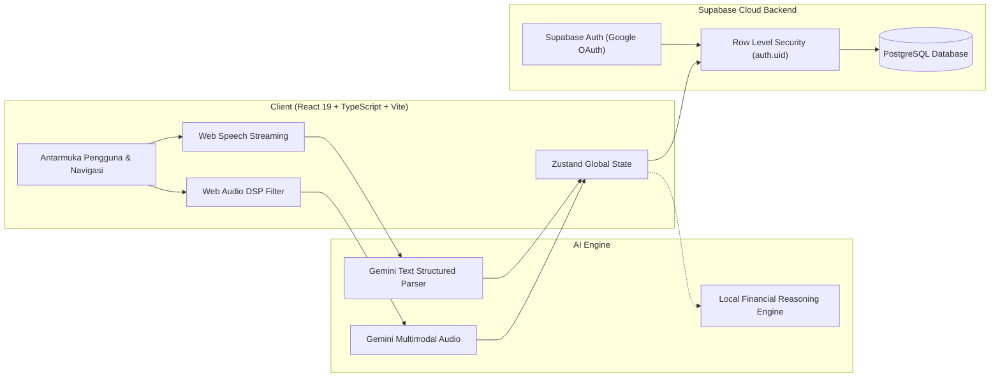

<div align="center">

<a href="https://monetra-apps.vercel.app" target="_blank" rel="noopener noreferrer">
  
</a>

# Monetra

### Asisten Keuangan Pribadi Berbasis AI & Pelacak Pengeluaran Pintar
**Catat transaksi secepat berbicara, kelola anggaran dengan aturan 50/30/20, dan evaluasi kesehatan finansial Anda secara real-time.**

[**Coba Aplikasi Sekarang (monetra-apps.vercel.app) »**](https://monetra-apps.vercel.app)

<br />

[](https://monetra-apps.vercel.app)
[](https://react.dev/)
[](https://www.typescriptlang.org/)
[](https://tailwindcss.com/)
[](https://vitejs.dev/)
[](https://supabase.com/)
[](https://ai.google.dev/)
[](LICENSE)

[Fitur Aplikasi](#-fitur-aplikasi-sesuai-hasil-akhir) • [Alur Voice AI & DSP](#-alur-voice-to-transaction--pemfilteran-dsp) • [Arsitektur & Teknologi](#-arsitektur--teknologi) • [Panduan Instalasi](#-panduan-instalasi--menjalankan-lokal) • [Struktur Proyek](#-struktur-direktori)

</div>

---

## Ringkasan Produk

Banyak orang gagal mengelola keuangan pribadi bukan karena tidak memiliki niat, melainkan karena proses pencatatan manual yang lambat, melelahkan, dan sering terlupakan. Aplikasi pencatat keuangan konvensional mengharuskan pengguna mengetik angka satu per satu, memilih kategori secara berulang, dan hanya berakhir sebagai buku kas pasif tanpa arahan perbaikan finansial.

**Monetra** dirancang untuk menyelesaikan masalah tersebut dengan pendekatan modern:
1. **Pencatatan Tanpa Mengetik:** Cukup ceritakan pengeluaran Anda lewat rekaman suara. Monetra langsung mengekstrak ucapan Anda menjadi catatan transaksi terstruktur dalam hitungan detik.
2. **Kecerdasan Kontekstual & Aturan 50/30/20:** AI secara otomatis mengelompokkan pos pengeluaran (*Kebutuhan*, *Keinginan*, dan *Tabungan*), mempelajari kebiasaan berbelanja Anda, dan memberi peringatan proaktif sebelum anggaran terlampaui.
3. **Privasi & Keamanan Penuh:** Data Anda diisolasi menggunakan *Row Level Security* (RLS) PostgreSQL di Supabase. Anda memegang kendali penuh atas data dan riwayat memori AI Anda.

---

## Fitur Aplikasi (Sesuai Hasil Akhir)

### 1. Pencatatan Suara Pintar (Voice-to-Transaction Modal)
* **Ekstraksi Multi-Transaksi dalam Satu Ucapan:** Sebutkan beberapa transaksi sekaligus (misal: *"Tadi makan siang soto 20 ribu, isi bensin 30 ribu, lalu ditransfer teman 100 ribu"*). AI langsung memecahnya menjadi 3 transaksi terpisah dengan nominal, tipe, dan kategori yang akurat.
* **Pemahaman Bahasa Percakapan Indonesia:** Mendukung berbagai istilah nominal kasual (*ceban, goceng, seceng, noceng, goban, cepek, 50 rebu, 1,5 juta*).
* **Rangkaian Filter Vokal Web Audio DSP:**
  * **85 Hz High-Pass Filter:** Memotong suara getaran genggaman tangan (*handling noise*), hembusan angin dekat, dan gemuruh *sub-bass*.
  * **2.400 Hz Vocal Formant Peaking Filter (+5.0 dB):** Mengangkat frekuensi artikulasi konsonan percakapan bahasa Indonesia agar terdengar jernih dan tegas.
  * **7.500 Hz Low-Pass Filter:** Memotong desis frekuensi tinggi (*hiss*), deru kipas angin, pendingin ruangan (AC), serta distorsi latar belakang.
  * **Dynamics Compressor (-32 dB threshold, 4.5:1 ratio):** Menangkap suara pelan atau bisikan tanpa membuat suara keras menjadi pecah (*clipping*).
* **Streaming Teks Real-Time:** Menampilkan kata demi kata yang sedang diucapkan secara langsung pada layar di browser mobile (iOS Safari iPhone 15 Pro Max & Android Chrome).
* **Kartu Konfirmasi:** Tinjau dan edit hasil ekstraksi sebelum disimpan ke database dengan satu ketukan.

### 2. Beranda Finansial (Dashboard)
* **Ringkasan Saldo Komprehensif:** Pemantauan Saldo Bersih (*Net Worth*), Total Pemasukan, Total Pengeluaran, dan Saldo Tabungan.
* **Daily Financial Insight:** Analisis ringkas harian berbasis kebiasaan transaksi terbaru untuk menjaga kedisiplinan keuangan.
* **Aksi Cepat (Quick Actions):** Akses instan untuk Catat Suara (*Voice*), Catat Manual Cepat, dan Tinjauan Analisis.
* **Riwayat Transaksi Terkini:** Daftar transaksi terbaru dengan kartu berdesain *glassmorphism* dan indikator kategori visual.

### 3. Detail & Manajemen Transaksi (Transactions)
* **Filter Cepat:** Navigasi antara tab *Semua*, *Pengeluaran*, dan *Pemasukan*.
* **Pencarian Instan:** Temukan riwayat transaksi berdasarkan catatan maupun nama kategori.
* **Modal Detail Transaksi Bebas Bug:** Tampilan pop-up detail transaksi responsif yang dilengkapi mekanisme `useScrollLock` (mencegah scroll pada latar belakang saat modal aktif) serta rendering portal body anti-terpotong di mobile.
* **Aksi Edit & Hapus dengan Fitur Undo:** Fleksibilitas mengubah rincian transaksi atau membatalkan penghapusan secara instan.

### 4. Statistik & Analisis Finansial (Analytics)
* **Peralihan Rentang Waktu Fleksibel:** Tombol switcher di pojok kanan atas untuk melihat statistik berbasis **Mingguan**, **Bulanan**, atau **Tahunan**.
* **Visualisasi Arus Kas (Cash Flow Chart):** Diagram batang interaktif perbandingan arus kas pemasukan vs pengeluaran berbasis Recharts.
* **Evaluasi Alokasi 50/30/20:**
  * **Kebutuhan (Needs - 50%):** Makanan pokok, tagihan listrik/air, transportasi, kesehatan.
  * **Keinginan (Wants - 30%):** Hiburan, belanja hobi, kuliner kafe, rekreasi.
  * **Tabungan & Investasi (Savings - 20%):** Tabungan masa depan, dana darurat, cicilan produktif.
* **Distribusi Pengeluaran:** Diagram donat persentase pengeluaran berdasarkan kategori.

### 5. Asisten Keuangan AI (FinAI Assistant)
* Konsultan keuangan pribadi interaktif berbasis Google Gemini dengan *Local Financial Reasoning Engine* sebagai fallback.
* Input percakapan dapat dilakukan melalui ketikan teks maupun rekaman suara langsung di ruang obrolan.
* Dilengkapi *Interactive Cards* untuk menampilkan daftar transaksi yang baru dicatat, peringatan batas anggaran, dan kalkulasi simulasi.
* **AI Memory Engine:** Secara adaptif mengingat preferensi pengguna, target tabungan, dan kebiasaan pengeluaran untuk memberikan rekomendasi yang semakin personal seiring waktu.

### 6. Anggaran, Target Tabungan & Buku Utang (Budget & Goals)
* **Batas Anggaran Bulanan:** Tetapkan batas pengeluaran per kategori lengkap dengan indikator persentase pemakaian visual (Aman / Peringatan / Jebol).
* **Target Impian (Financial Goals):** Pantau progres pencapaian target tabungan beserta estimasi waktu pencapaian (*deadline*).
* **Buku Utang & Piutang:** Catat dana yang Anda pinjamkan kepada orang lain atau dana yang harus Anda bayarkan, lengkap dengan tanggal jatuh tempo dan penanda status lunas.

### 7. Pengaturan & Akun (Settings)
* **Profil Finansial:** Konfigurasi nama, email, mata uang, tanggal gajian, dan rata-rata penghasilan bulanan.
* **Preferensi Gaya AI:** Pilihan gaya komunikasi santai atau formal.
* **Manajemen Gemini API Key:** Input kunci API Gemini pribadi yang tersimpan aman di penyimpanan privat peramban.
* **Pusat Memori AI:** Kelola, tinjau, atau hapus memori kebiasaan yang disimpan oleh asisten AI.
* **Ekspor & Reset Data:** Unduh cadangan riwayat transaksi atau bersihkan seluruh data akun kapan saja.

### 8. Desain "Titanium & Ember" & Progressive Web App (PWA)
* **Estetika Glassmorphism Premium:** Kombinasi baja gelap (*ink titanium*) dengan aksen tembaga hangat (*ember copper*).
* **Nir-Emoji (Zero-Emoji Policy):** Menggunakan ikon vektor garis tipis (SVG) Lucide murni untuk tampilan profesional setara platform finansial institusional.
* **Dua Tema:** Tema gelap (*Dark Titanium*) sebagai tampilan bawaan dan tema terang (*Porcelain Mist*).
* **PWA Ready:** Dapat diinstal langsung ke layar utama (*Add to Home Screen*) pada perangkat iPhone (iOS Safari) maupun Android (Chrome).

---

## Alur Voice-to-Transaction & Pemfilteran DSP

Sistem pencatatan suara Monetra dirancang tangguh untuk penggunaan di luar ruangan atau lingkungan ramai:

```
[ Mikrofon Ponsel / Laptop ]
              │
              ▼
┌──────────────────────────────────────────────┐
│       Web Audio Vocal DSP Filter Chain       │
│  ├─ 85 Hz High-Pass (potong gemuruh/angin)   │
│  ├─ 2.400 Hz Peaking (+5 dB formant vokal)   │
│  ├─ 7.500 Hz Low-Pass (potong desis/AC)      │
│  └─ Dynamics Compressor (-32 dB threshold)   │
└──────────────────────────────────────────────┘
              │
      Audio Bersih & Ternormalisasi
              │
              ▼
┌──────────────────────────────────────────────┐
│         Gemini Multimodal Neural AI          │
│  ├─ Isolasi vokal manusia di latar bising    │
│  ├─ Ekstraksi multi-transaksi otomatis       │
│  └─ Pengenalan istilah gaul rupiah           │
└──────────────────────────────────────────────┘
              │
              ▼
┌──────────────────────────────────────────────┐
│        Struktur Transaksi Terverifikasi      │
│  ├─ Nominal & Tipe (Pengeluaran/Pemasukan)   │
│  ├─ Auto-Kategori (Makanan, Bensin, dsb.)    │
│  └─ Klasifikasi 50/30/20 (Need/Want/Saving)  │
└──────────────────────────────────────────────┘
```

---

## Arsitektur & Teknologi



### Rincian Pustaka Utama

| Komponen | Pustaka / Layanan | Fungsi & Keunggulan |
| :--- | :--- | :--- |
| **Framework** | [React 19](https://react.dev/) | Library UI berbasis komponen modern |
| **Bahasa** | [TypeScript](https://www.typescriptlang.org/) | Keamanan tipe statis penuh di seluruh alur data |
| **Styling** | [Tailwind CSS v4](https://tailwindcss.com/) | Utilitas CSS modern berperforma tinggi |
| **Bundler** | [Vite 8](https://vitejs.dev/) | Waktu dev server instan dan kompilasi produksi cepat |
| **State Manager** | [Zustand](https://github.com/pmndrs/zustand) | State management ringan dengan sinkronisasi penyimpanan lokal |
| **Grafik Data** | [Recharts](https://recharts.org/) | Diagram arus kas batang dan donat kategori responsif |
| **Animasi** | [Framer Motion](https://www.framer.com/motion/) | Transisi layar, modal dialog, dan animasi gelombang audio |
| **Ikon** | [Lucide React](https://lucide.dev/) | Ikon SVG garis tipis profesional |
| **Database & Auth** | [Supabase](https://supabase.com/) | PostgreSQL dengan Row Level Security & Google OAuth |
| **Model AI** | [Google Gemini 2.5 Flash](https://ai.google.dev/) | Transkripsi multimodal dan inferensi keuangan cerdas |

---

## Panduan Instalasi & Menjalankan Lokal

### Prasyarat Sistem
* [Node.js](https://nodejs.org/) versi 18.0 atau yang lebih baru.
* Manajer paket: `npm`, `pnpm`, atau `yarn`.
* Akun [Supabase](https://supabase.com/) (tersedia tier gratis).
* *(Opsional)* Google Gemini API Key dari [Google AI Studio](https://aistudio.google.com/).

### 1. Kloning Repositori
```bash
git clone https://github.com/RendyGH7/Monetra-Apps.git
cd Monetra-Apps
```

### 2. Pasang Dependensi
```bash
npm install
```

### 3. Konfigurasi Environment Variables
Salin berkas template lingkungan ke `.env.local`:
```bash
cp .env.example .env.local
```

Buka berkas `.env.local` dan isi nilainya:
```env
# Konfigurasi Supabase
VITE_SUPABASE_URL=https://proyek-anda.supabase.co
VITE_SUPABASE_ANON_KEY=kunci-anon-proyek-anda

# Kunci API Google Gemini (Opsional, dapat juga diatur via menu Pengaturan)
VITE_GEMINI_API_KEY=kunci-gemini-anda
```

### 4. Eksekusi Skema Database Supabase
Jalankan berkas migrasi SQL yang tersedia di folder `supabase/migrations/` pada **SQL Editor** di dasbor Supabase Anda:
1. `supabase/migrations/20261028_init_finai_schema.sql` (Tabel profil, transaksi, kategori, dompet, budget, goal, memori).
2. `supabase/migrations/20261030_create_monetra_user_data.sql` (Aturan keamanan RLS dan indeks performa).

### 5. Jalankan Server Pengembangan
```bash
npm run dev
```
Buka peramban di `http://localhost:5173`.

### 6. Kompilasi untuk Produksi
```bash
npm run build
```
Hasil berkas siap rilis berada di direktori `dist/` dan siap di-deploy ke Vercel, Netlify, atau Cloudflare Pages.

---

## Struktur Direktori

```
Monetra-App/
├── public/                 # Favicon resmi (favicon.svg), manifest PWA, & aset logo
├── src/
│   ├── components/         # Komponen antarmuka modular
│   │   ├── common/         # Toast notification, Markdown message renderer, Quick manual modal
│   │   ├── layout/         # Navigasi bawah (BottomNav), Sidebar navigasi, Maskot
│   │   └── voice/          # Modal perekaman suara, visualizer audio, & filter Web Audio DSP
│   ├── data/               # Data inisial kategori, profil default, dan data awal
│   ├── features/           # Halaman utama aplikasi
│   │   ├── analytics/      # Grafik arus kas & alokasi 50/30/20 (Mingguan, Bulanan, Tahunan)
│   │   ├── assistant/      # Chat interaktif asisten finansial AI bertenaga Gemini
│   │   ├── auth/           # Layar masuk Google OAuth & email
│   │   ├── budget/         # Anggaran bulanan, target impian (goals), & buku utang-piutang
│   │   ├── dashboard/      # Ringkasan saldo, statistik kilat, dan aksi cepat
│   │   ├── settings/       # Profil, gaya bahasa AI, kunci API, memori, & ganti tema
│   │   └── transactions/   # Riwayat transaksi, pencarian, dan modal detail transaksi
│   ├── lib/                # Konfigurasi klien Supabase
│   ├── services/           # Integrasi AI Gemini Multimodal, Parser Suara, & Local Brain
│   ├── store/              # Global state management berbasis Zustand
│   ├── types/              # Definisi tipe TypeScript
│   └── utils/              # Pemformat rupiah, waktu WIB, useScrollLock, & kalkulasi
├── supabase/
│   └── migrations/         # Skrip SQL skema tabel database dan kebijakan RLS
├── package.json            # Daftar dependensi dan script npm
├── vite.config.ts          # Konfigurasi bundler Vite
├── LICENSE                 # Lisensi open-source MIT
└── README.md               # Dokumentasi resmi proyek
```

---

## Keamanan & Perlindungan Privasi

* **Row Level Security (RLS):** Seluruh baris data pada PostgreSQL dilindungi oleh aturan ketat `auth.uid() = user_id`. Tidak ada pengguna yang dapat melihat atau mengakses data finansial pengguna lain.
* **Pemrosesan Audio Tanpa Jejak:** Rekaman audio hanya diproses di memori sesi untuk dianalisis oleh AI dan tidak disimpan secara permanen di server publik.
* **Kunci API Mandiri & Privat:** Kunci API Gemini disimpan secara lokal di peramban pengguna atau melalui proxy aman.
* **Kontrol Penuh atas Data:** Pengguna memiliki hak penuh untuk mengekspor atau menghapus seluruh riwayat transaksi dan memori AI kapan saja.

---

## Lisensi

Proyek ini didistribusikan di bawah ketentuan lisensi **MIT**. Rincian lengkap dapat dilihat pada berkas [LICENSE](LICENSE).

<div align="center">

Dibangun untuk membantu setiap orang mencapai ketertiban finansial dengan cepat, akurat, dan tanpa stres.

**[Tim Pengembang Monetra](https://github.com/RendyGH7/Monetra-Apps)**

</div>
